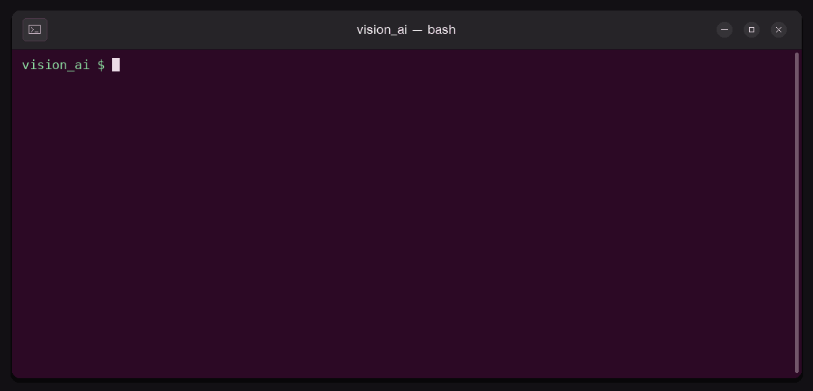

# 건설용 자갈 암석 이미지 분류

## 프로젝트 개요

- 분류 대상은 건설용 자갈 사진, 출력은 7개 암석 클래스
- **Ubuntu 24.04에서 개발 및 실험**
- PyTorch와 CUDA로 ConvNeXt-Base 학습
- Bash 스크립트로 환경 설정, 5폴드 학습, 체크포인트 추론 및 평가

[Ubuntu 실행 스크립트](scripts/rock.sh) | [프로젝트 발표 자료 PDF](docs/presentation.pdf) | [데이터 및 모델 상세 설명](docs/MODEL.md)

## 개발 및 학습 환경

| 구성 | 사양 |
| --- | --- |
| 운영체제 | Ubuntu 24.04 Linux |
| GPU | NVIDIA GeForce RTX 4080 SUPER, VRAM 16GB |
| CPU | Intel Core i9-14900K |
| 메모리 | 64GB |
| 주요 도구 | Bash, Python, PyTorch, CUDA, timm, Albumentations, OpenCV |

- 학습에 CUDA 혼합 정밀도 사용
- 단일 이미지 추론 및 체크포인트 평가는 CUDA 사용 가능 시 GPU에서 실행
- CPU 실행 옵션은 `--device cpu`

## 데이터셋

- [DACON 건설용 자갈 암석 종류 분류 AI 경진대회 데이터 다운로드](https://dacon.io/competitions/official/236471/data)
- 학습용 JPG 380,020장, 테스트용 JPG 95,006장
- 학습 데이터 7개 클래스는 `Andesite`, `Basalt`, `Etc`, `Gneiss`, `Granite`, `Mud_Sandstone`, `Weathered_Rock`

### Ubuntu 학습 데이터 배치

```text
/home/kangjungmin1/open/
├── train/
│   ├── Andesite/
│   │   └── TRAIN_00000.jpg
│   ├── Basalt/
│   ├── Etc/
│   ├── Gneiss/
│   ├── Granite/
│   ├── Mud_Sandstone/
│   └── Weathered_Rock/
├── test/
│   └── TEST_00000.jpg
├── train.csv
├── test.csv
├── test_modified.csv
└── sample_submission.csv
```

- `train.csv`와 `test.csv`는 대회 배포본에 포함
- 학습 코드는 `train/`에서 JPG를 읽고 클래스 폴더 이름을 오름차순으로 정렬해 라벨 부여
- `test_modified.csv`는 원본 `test.csv`의 `img_path`를 Ubuntu 환경에서 읽을 수 있는 경로로 수정한 파일
- 테스트 이미지 경로는 절대 경로 또는 명령 실행 위치 기준 상대 경로 사용
- `sample_submission.csv`는 제출 양식으로 사용하며 테스트 CSV의 행 수와 순서를 유지
- [참고 저장소의 폴더 구조](https://github.com/parag0hz/rock_classification_dacon#2-폴더-구조) | [데이터 및 검증 CSV 형식](docs/MODEL.md)

## Ubuntu에서 실행

[실행 스크립트 `scripts/rock.sh`](scripts/rock.sh)

### 환경 설정

저장소 루트에서 가상환경을 만들고 의존성 설치

```bash
sudo apt install python3-venv
python3 -m venv .venv
.venv/bin/python -m pip install 'torch>=2.6' 'timm>=1,<2' 'albumentations>=2,<3' opencv-python-headless pandas numpy scikit-learn tqdm
./scripts/rock.sh --help
```

| 명령 | 입력과 결과 |
| --- | --- |
| `train` | 5폴드 학습 및 TTA 앙상블로 제출 CSV 생성 |
| `predict` | 이미지 한 장과 체크포인트를 입력받아 클래스 번호와 softmax 확률을 JSON으로 출력 |
| `evaluate` | 검증 CSV와 체크포인트 하나로 정확도, macro F1, 클래스별 지표, 혼동행렬 계산 |
| `evaluate-folds` | 검증 CSV와 체크포인트를 폴드별로 짝지어 평가하고 `runs/evaluate-*/foldN.json`에 저장 |

### 학습 및 산출물

```bash
./scripts/rock.sh train
```

- 학습 로그는 `runs/train-*/train.log`에 저장
- 검증 정확도가 개선될 때 해당 폴드의 체크포인트 저장(`best_model_fold1.pth`부터 `best_model_fold5.pth`까지)
- 제출용 추론 후 `submit_convnext.csv` 생성
- 체크포인트와 제출 CSV는 데이터 디렉터리에 저장하며 기존 파일은 덮어쓸 수 있음

### 체크포인트 추론 및 평가




- 단일 이미지 추론은 분류할 이미지와 학습에서 생성한 체크포인트 경로 지정
- 단일 폴드 평가는 검증 이미지 경로와 정답이 담긴 CSV 및 해당 폴드의 체크포인트 경로 지정
- 5폴드 평가는 검증 CSV(`fold1.csv`~`fold5.csv`)와 체크포인트(`best_model_fold1.pth`~`best_model_fold5.pth`)를 같은 폴드 번호로 연결

```bash
./scripts/rock.sh predict /path/to/rock.jpg --checkpoint /path/to/best_model_fold1.pth
./scripts/rock.sh evaluate /path/to/fold1.csv --checkpoint /path/to/best_model_fold1.pth
./scripts/rock.sh evaluate-folds /path/to/validation-folds /path/to/checkpoints --batch-size 8
```

## 모델과 실험 결과

### 학습 설정
- LAB 색 공간의 밝기 채널에 CLAHE를 적용하고 224×224로 크기 조정 후 ImageNet 기준으로 정규화
- 사전 학습된 ConvNeXt-Base를 층화 5폴드로 학습
- 클래스별 이미지 수 차이를 보정하기 위해 샘플링과 손실 함수에 가중치 적용
- 제출용 추론에서 테스트 시점 증강(TTA)을 적용하고 각 폴드의 최고 검증 정확도를 기준으로 예측 확률을 가중 평균

### 모델별 F1

| 모델 | F1 |
| --- | ---: |
| ViT-L/16 | 0.66588 |
| Swin V2 | 0.72668 |
| ConvNeXt-Base | 0.83635 |

- 비교한 세 모델 중 ConvNeXt-Base가 가장 높은 F1 기록(0.83635)
- [모델 비교표(PDF 23쪽)](docs/presentation.pdf#page=23)

## 저장소 구성

| 경로 | 역할 |
| --- | --- |
| [scripts/rock.sh](scripts/rock.sh) | Ubuntu 환경에서 학습, 추론, 반복 평가 실행 |
| [model.py](model.py) | 이미지 전처리, 모델 학습, TTA 앙상블 및 제출 CSV 생성 |
| [predict.py](predict.py) | 체크포인트를 사용한 단일 이미지 분류 |
| [evaluate.py](evaluate.py) | 검증 데이터로 체크포인트 평가 |
| [docs/](docs/) | 데이터 및 모델 상세 설명, 발표 PDF |
